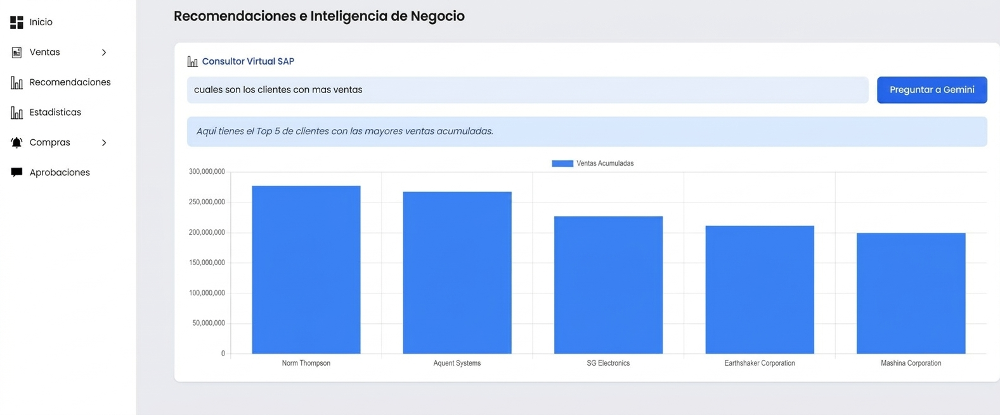

# 📊 SAP Business One Conversational BI & Executive Assistant

> **Solution Architecture & AI Integration Case Study** — Bridging Enterprise ERP data (SAP Service Layer) with Generative AI (Google Gemini) for real-time executive decision-making.

---

## 🎯 Business Challenge
In enterprises running **SAP Business One**, executives and department heads often depend on static reports or IT support tickets to obtain ad-hoc commercial and financial KPIs. This bottleneck delays operational decisions and overloads technical teams with routine data extraction requests.

## 💡 Solution Overview
I designed and led the implementation of a web-based **Virtual SAP Consultant** that enables natural language querying over live ERP data. Business users ask questions in plain language (covering Sales, Purchasing, and Approvals) and receive immediate executive summaries along with dynamic charts, without needing SQL skills or navigating complex ERP menus.

## 🏗️ Solution Architecture

```text
[ Executive User (Web UI) ]
       │  1. Natural Language Query (e.g., "Top 5 customers by sales")
       ▼
[ API Orchestration Layer ]
       │  2. Intent Parsing & Query Translation
       ├──► [ Google Gemini API ] ──► Structures data request parameters
       │
       ▼  3. Authenticated OData Call
[ SAP Business One Service Layer ] ──► Retrieves real-time ERP entities
       │
       ▼  4. Visualization Engine
[ Executive BI Dashboard ] ──► Renders summary & interactive bar charts
```

## 🖥️ System Preview



## 📈 Business Value & Architecture Benefits
* **Self-Service Executive Analytics:** Instant access to sales and purchasing KPIs without waiting for custom report development.
* **Reduced IT Workload:** Eliminates repetitive data-extraction tickets for the internal ERP team.
* **Standard & Secure Governance:** Built strictly on **SAP Service Layer (OData)**, respecting all native SAP business logic and user authorization profiles without direct database access.

## 🛠️ Technologies & Standards
* **ERP & Integration:** SAP Business One, SAP Service Layer (OData / REST)
* **AI & Automation:** Google Gemini API
* **Web Architecture:** Modern Web UI, RESTful Middleware
* **Enterprise Design:** API-First Integration, Business Process Optimization
